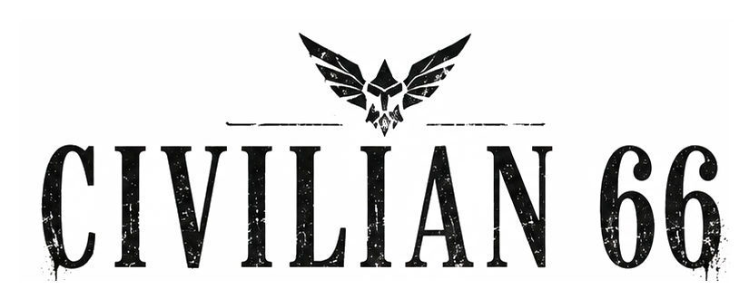
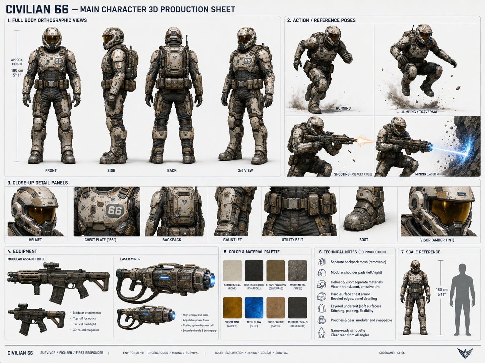

<h1 align="center">
  
</h1>

  <strong>CRASH. SURVIVE. BUILD. EARN A NAME. BREAK THE SURFACE. CHANGE THE WORLD.</strong> 
  <em>A science-fiction adventure from the underground to the surface and beyond.</em>

<table align="center">
<tr>
<td width="55%" valign="middle">
<h2>One civilian. One living world. A colony to build.</h2>

On humanity's first large-scale one-way colony mission, the player crash-descends into an infested, shifting underground as <strong>Civilian 66</strong>; a number, not a chosen hero. Survive the Mines, make a settlement where none was prepared, and reconstruct the five-part drill that can break through to the surface.

Above, a new frontier opens into exploration and first contact. The presumed-dead Civilian 143, Clarissa, reached the surface first; meeting her is the moment Civilian 66 earns a name. Later, the Subvergence transforms the planet with magic. The journey ends with a civilization capable of sending Earth its first message from the colony: <strong>"Hello World."</strong>

<strong>Designed as:</strong> exploration · defense · building · crafting · action combat · strategy · persistent settlement growth

</td>
<td width="45%" valign="top">

</td>
</tr>
</table>

  <a href="#the-journey">THE JOURNEY</a> &nbsp;·&nbsp;
  <a href="#how-it-plays">HOW IT PLAYS</a> &nbsp;·&nbsp;
  <a href="#design-pillars">DESIGN PILLARS</a> &nbsp;·&nbsp;
  <a href="#world-and-art-direction">WORLD &amp; ART</a> &nbsp;·&nbsp;
  <a href="#review-the-project">PROJECT GUIDE</a>

<h2 id="the-journey">01 &nbsp;|&nbsp; The journey</h2>

Civilian 66 is designed to grow in scale and change its survival language as the player changes the world. Reaching the surface opens the next major game layer; it does not finish the adventure.

<table>
<tr>
<td width="50%" valign="top">
<h3>01 · The Mines</h3>

Crash-descend into a dangerous, procedurally shifting underground. Explore, scout, fight, mine, craft, trade, and build a settlement that can survive. Recover the parts of the heavy drill and prepare the foothold needed to reach the surface.

</td>
<td width="50%" valign="top">
<h3>02 · The Surface</h3>

Breaking through opens a second game layer: 3D frontier exploration and first contact. Meet Clarissa, learn stealth and reconnaissance, and discover how much of the planet, and the colony's story, remains unknown.

</td>
</tr>
<tr>
<td width="50%" valign="top">
<h3>03 · The Subvergence</h3>

A planetary transformation introduces magic into a world that did not begin with it. Familiar places and life change. New dangers and forms of exploration arrive while mining, combat, and settlement defense remain relevant.

</td>
<td width="50%" valign="top">
<h3>04 · A future for the colony</h3>

Grow from an isolated foothold into a civilization. The colony's journey culminates in building a satellite to send Earth its first message from the new world: <strong>"Hello World."</strong>

</td>
</tr>
</table>

<h3>The people who change what survival means</h3>

<table>
<tr>
<td width="33%" valign="top"><strong>The Hero · Civilian 66</strong> Wins ground through survival, combat, mining, construction, and the ability to keep others alive.</td>
<td width="33%" valign="top"><strong>Clarissa · Civilian 143</strong> Proves survival can come from intelligence, stealth, and opportunism; her meeting with the Hero makes a personal name possible.</td>
<td width="33%" valign="top"><strong>Bruce</strong> Turns survival into infrastructure, trade, and repeatable civilization.</td>
</tr>
</table>

<h2 id="how-it-plays">02 &nbsp;|&nbsp; How it plays</h2>

Each expedition connects the player, the settlement, and the world. Major progress should make the player more capable, the settlement more viable, or the world more open.

<table>
<tr>
<td width="50%" valign="top"><h3>01 · Venture out</h3>Leave relative safety for hostile tunnels or, later, the surface. Scout, explore, fight, and identify useful territory.</td>
<td width="50%" valign="top"><h3>02 · Bring something back</h3>Mine or recover materials and supplies. Manage equipment, carrying capacity, and the risk of staying out too long.</td>
</tr>
<tr>
<td width="50%" valign="top"><h3>03 · Build capability</h3>Return to the settlement to process, trade, research, and prepare. Spend Credits, materials, and Skill Points on real outcomes.</td>
<td width="50%" valign="top"><h3>04 · Change the frontier</h3>Build defenses, utilities, storage, interiors, and new settlement footprint. Reach story, ecology, merchant, and boss milestones; then venture farther.</td>
</tr>
</table>

### What kind of game to expect

- A **polished single-player** science-fiction adventure. Co-op is not a launch promise.
- An expanding blend of **exploration, defense, building, crafting, action combat, and strategy** with persistent settlement growth.
- **Modern 3D** play with interchangeable first- and third-person cameras.
- A living underground and surface world where building and civilization are part of campaign progression, not end-state decoration.
- The 2D *Crawl Brawl* game preserved as a playable arcade game within the world.
- A **Windows PC / Steam** target, designed with Steam Deck in mind.

<h2 id="design-pillars">03 &nbsp;|&nbsp; Design pillars</h2>

<table>
<tr><th>Design promise</th><th>What it means for the player</th></tr>
<tr><td><strong>Violent frontier survival</strong></td><td>Safety is created, defended, and expanded; it is never assumed.</td></tr>
<tr><td><strong>Build to progress</strong></td><td>Campaign advancement comes from what the player establishes, powers, researches, and protects.</td></tr>
<tr><td><strong>Exploration has consequences</strong></td><td>Discovery brings resources, new ecologies, pressure, and future challenges.</td></tr>
<tr><td><strong>Civilization is gameplay</strong></td><td>Civilians, shops, interiors, trade, services, and settlement growth are active systems.</td></tr>
<tr><td><strong>The game changes genre layers without abandoning its roots</strong></td><td>Underground survival expands into surface exploration and stealth, then changes again with the Subvergence. Mining and defense continue to matter.</td></tr>
</table>

<h2 id="world-and-art-direction">04 &nbsp;|&nbsp; World &amp; art direction</h2>

Visuals change with the journey. The Mines are dark and rich in material; threats and useful objects must read clearly. The surface is a visual release while remaining alien and dangerous. Buildings look assembled, repaired, and expanded by survivors. After the Subvergence, familiar places transform rather than giving way to a disconnected fantasy world.

  

<em>Main character production concept · art direction reference, not final in-game footage</em>

<h2 id="review-the-project">05 &nbsp;|&nbsp; Review the project</h2>

Start with the game direction, then follow whichever part of the public project you want to inspect:

<table>
<tr>
<td width="50%" valign="top">
<h3><a href="ARCHITECTURE.md">Architecture &amp; code sets</a></h3>

A high-level map of the Unreal C++ modules and their responsibilities. These descriptions provide implementation context; they are not the full source.

</td>
<td width="50%" valign="top">
<h3><a href="RESOURCES.md">Resource credits</a></h3>

Selected third-party resource sources and attribution. This page does not redistribute resource files.

</td>
</tr>
<tr>
<td width="50%" valign="top">
<h3><a href="https://github.com/RawPowered/Civilian66">Private production repository</a></h3>

Complete source, current Game Bible, production assets, and detailed project records. Access is restricted.

</td>
<td width="50%" valign="top">
<h3>How to read this showcase</h3>

The creative direction follows Game Bible v1.10. This public repository is a curated design and code-set overview, not a playable release. Design targets describe the intended game; they do not claim every feature is already implemented.

</td>
</tr>
</table>

<table align="center"><tr><td bgcolor="#FFFFFF"></td></tr></table>

CIVILIAN 66 · ACTIVE DEVELOPMENT

