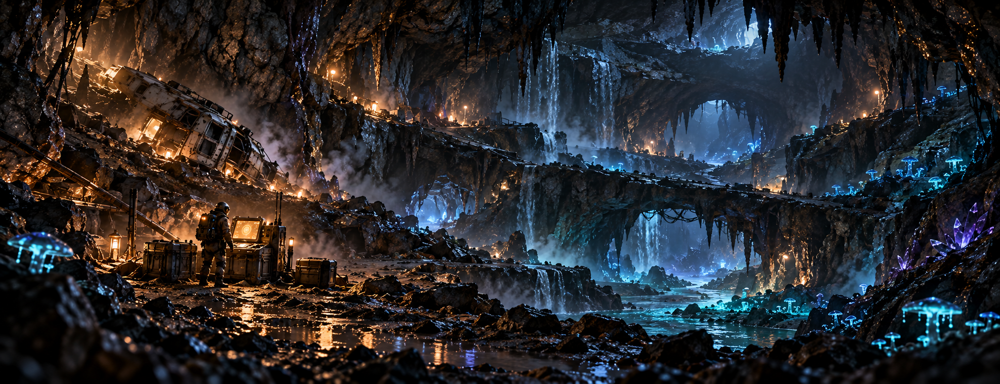
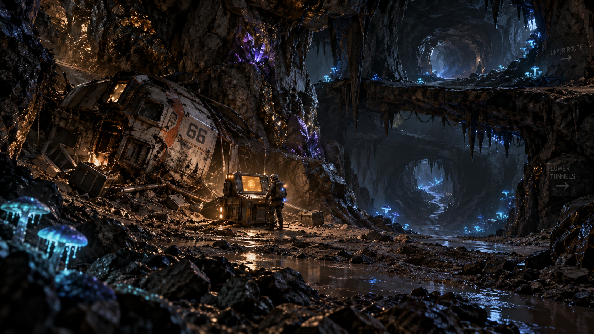
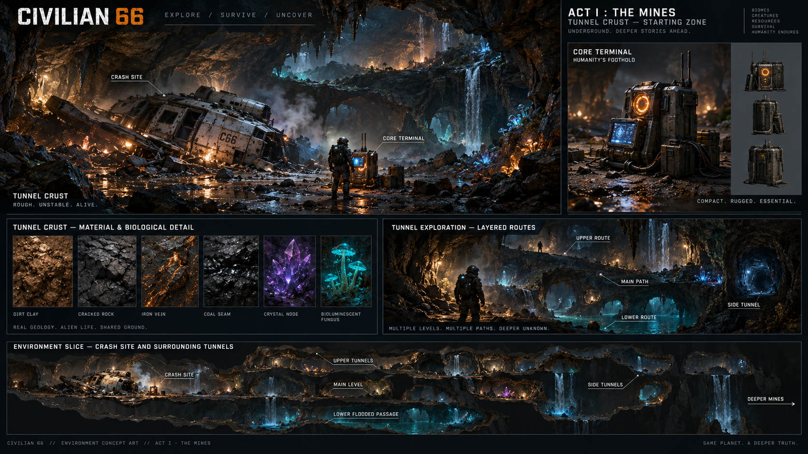

  
   
  <strong>EXPLORE&nbsp;&nbsp;·&nbsp;&nbsp;SURVIVE&nbsp;&nbsp;·&nbsp;&nbsp;UNCOVER</strong>
    
  
  
  

 

  

<h1 align="center">A deeper world lies below.</h1>

Civilian 66 is a science-fiction survival and exploration game about making a life underground, one hard-won foothold at a time. Mine through a vast subterranean world, turn what you recover into the tools and shelter you need, then push farther into places no one has mapped.

Your first goal is to stay alive. The deeper you go, the more the world asks of you—and the more there is to discover.

> **The promise:** survival with purpose, mining that changes the world around you, and exploration that opens into a larger story.

## What kind of game to expect

- **Survival adventure:** manage risk and supplies as you venture away from safety.
- **Hands-on mining:** cut through rock, open routes, and make choices about where—and how—to dig.
- **Resource-driven growth:** recover useful materials, process them, and improve your ability to survive and explore.
- **A world to read:** follow geology, cave life, wreckage, and traces of human activity to understand your surroundings.
- **A story that expands:** begin with immediate survival in the mines; the wider world and its history unfold through exploration.

Civilian 66 is being built as a 3D, authored science-fiction game with interconnected systems for control, equipment, mining, world simulation, progression, and presentation. The exact mix of combat, crafting, construction, and campaign systems will be refined as development continues.

## The experience

### 01 — Find a foothold

Start with limited equipment in a hostile underground environment. Learn what can be trusted, secure the essentials, and make a temporary refuge dependable enough to return to.

### 02 — Make your own way

Mining is both a way to gather resources and a way to travel. Open useful passages, choose between routes, and learn how the surrounding world responds to your work.

### 03 — Turn resources into capability

Bring materials back, process what you find, and use your gains to become better equipped for the next expedition. Progress comes from preparing well and deciding what is worth the risk.

### 04 — Go farther, learn more

Each descent reveals new terrain, life, and evidence of a much larger human story. The mines are the beginning of the journey, not its whole horizon.

## World & visual direction

The first environment direction pairs rugged, wet stone and improvised human equipment with sparse bioluminescent life. Warm amber work lights give way to cool blue and teal depths. The mood is grounded and atmospheric: a place shaped by geology, labor, isolation, and things still unknown.

  

<em>Starting-zone concept direction · work in progress</em>

  

<em>Tunnel Crust environment study · work in progress</em>

## Design pillars

| Pillar | What it means in play |
|---|---|
| **Survival earns progress** | Preparation, a dependable refuge, and careful expeditions make deeper exploration possible. |
| **The world is the route** | Mining changes the spaces you move through and the opportunities you can reach. |
| **Resources have a journey** | Finding, carrying, processing, and using materials connect exploration to growth. |
| **Systems serve the fiction** | Tools, world simulation, progression, and presentation support one coherent lived-in world. |
| **Discovery keeps widening** | Each new place should raise useful questions about the world and its people. |

## Development status

Civilian 66 is in active development. The private production project contains the full source, design bible, and working assets. This public repository is a branded project overview and selected design reference; it is not the complete game or a playable release. Descriptions here communicate the intended direction, and do not claim that every planned feature is already implemented.

## Explore the project

- [Architecture & code sets](ARCHITECTURE.md) — how the game's major systems fit together
- [Resource credits](RESOURCES.md) — selected third-party sources and attribution
- [Private production repository](https://github.com/RawPowered/Civilian66) — access is restricted

   
  <strong>CIVILIAN 66</strong> 
  STAY ALIVE. GO DEEPER.

